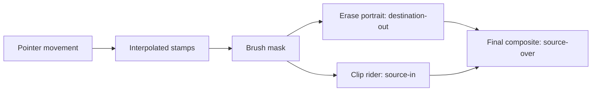
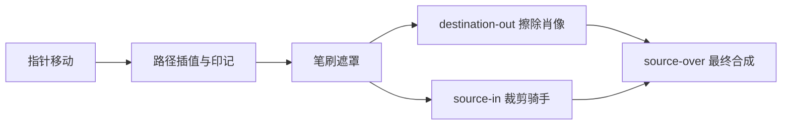

<a id="top"></a>

<div align="center">

# WebDesign8 · Rider

### One portrait. Two identities. Paint the transformation.

A hands-on guide to Canvas masking, organic brush trails, and electric particle effects.


**[English tutorial](#english)** · **[简体中文教程](#chinese)**

</div>

<table>
  <tr>
    <td width="50%"><a href="./index.html"></a></td>
    <td width="50%"><a href="./blue-lightning.html"></a></td>
  </tr>
  <tr>
    <td align="center"><b>PINK RIDER</b><br>Soft pink · Racing details · Organic reveal</td>
    <td align="center"><b>BLUE LIGHTNING</b><br>Violet armor · Cyan circuitry · Electric arcs</td>
  </tr>
</table>

---

<a id="english"></a>

## English

Turn a static portrait into an interactive costume change. Move the pointer to paint a torn-edge trail, reveal the rider underneath, and watch the portrait return as each mark shrinks away.

Each edition is an independent HTML file with inline CSS and JavaScript. No framework or build step is required. The original Pink Rider edition remains intact alongside the new Blue Lightning edition.

**Read this guide:** [Quick start](#en-start) · [Design](#en-design) · [Reveal tutorial](#en-reveal) · [Lightning](#en-lightning) · [Customize](#en-customize) · [Troubleshooting](#en-help)

### Choose an edition

| Edition | Source file | What changes |
| :--- | :--- | :--- |
| **Pink Rider** | [index.html](./index.html) | Pink helmet, iridescent visor, white racing stripes, and heart patches. |
| **Blue Lightning** | [blue-lightning.html](./blue-lightning.html) | Violet armor, cyan visor, fitted upper-body geometry, sparks, and lightning. |

The covers capture moments during interaction. GitHub file links show the source; download an HTML file to experience the effect in a browser.

<a id="en-start"></a>

### 01 / Quick start

**Fastest path:** download the repository ZIP, extract it, then open `index.html` or `blue-lightning.html` in a modern browser.

**With Git and a local server:**

```bash
git clone https://github.com/ThreshoLdnnis/WebDesign8-Rider.git
cd WebDesign8-Rider
npx serve .
```

Open the local URL printed by the server, then select `/index.html` or `/blue-lightning.html`. The optional `npx` command requires Node.js and may download the server package.

> **Network dependencies:** portraits are embedded in both HTML files, and the pink rider is embedded too. Blue Lightning loads its rider from the supplied CloudFront URL. Both editions request Google Fonts, with system-font fallbacks.

**Try it:** move across the face and shoulders, make a faster stroke, then stop. On touch devices, drag to reveal; an idle brush wanders after roughly 2.5 seconds.

<a id="en-design"></a>

### 02 / Design notes

- **A quiet stage, a strong subject.** Baby-pink gradients frame the cutout portrait; large gray and black typography moves behind it in opposite directions.
- **A transformation you control.** Equipment appears only where the brush passes, allowing the portrait and rider to coexist in the same frame.
- **A torn silhouette.** Overlapping hard-edge circles produce an irregular outline; shrinking marks restore the portrait over time.
- **A separate electric layer.** Blue Lightning draws sparks above the figure without changing the reveal mask or intercepting pointer input.

The two marquee lines read **DREAM RIDE SPARKLE** and **RIDE PRETTY STAY BOLDER**.

<a id="en-reveal"></a>

### 03 / Build the torn-edge Reveal

**What you will learn:** pointer coordinates, stroke interpolation, temporary masks, Canvas compositing, and image registration.

#### Step 1 — Understand the canvases

| Surface | Responsibility |
| :--- | :--- |
| `#reveal` | Visible portrait/rider composite. |
| `mask` | Offscreen canvas containing the active brush marks. |
| `buf` | Offscreen canvas used to clip the rider to the mask. |
| `rider` | Blue edition only: caches the fitted rider image. |
| `#sparks` | Blue edition only: visible sparks and lightning overlay. |

`front` is the original portrait; `back` is the rider image. Keep those names in mind when following the rendering code.

#### Step 2 — Convert pointer motion into a continuous stroke

Pointer events provide viewport coordinates. Subtract the figure's top-left position to obtain coordinates inside the portrait:

```js
const rect = figure.getBoundingClientRect();
const x = clientX - rect.left;
const y = clientY - rect.top;
```

Fast motion produces widely spaced events. Interpolate between consecutive positions to fill the gaps:

```js
const step = Math.max(W, 260) * 0.04;
const count = Math.min(40, Math.max(1, Math.ceil(distance / step)));
```

The script adds intermediate marks, capped at 40 per input update. Leaving the hero clears the previous point, preventing a long connecting line on re-entry.

#### Step 3 — Give the brush an organic outline

Each stamp contains **3–5 overlapping solid circles**. Their angles, offsets, and radii vary randomly. The circles have hard edges, with normal Canvas edge antialiasing; no blurred radial gradient is used for this mask.

```js
const base = Math.max(W, 260) * (coarse ? 0.15 : 0.12);
const n = 3 + Math.floor(Math.random() * 3);
// Store position, creation time, and the generated circles.
stamps.push({ x, y, t: now, lobes });
```

The mask is cleared and rebuilt from the remaining stamps every frame. A stamp lives for **1100ms**: it holds its size for about **275ms**, then shrinks until it expires.

```js
const k = Math.max(0, 1 - age / LIFE);
const scale = k < 0.75 ? k / 0.75 : 1;
// Lobe offsets use scale; lobe radii use scale ** 0.8.
```

The disappearing trail is primarily a **geometric contraction**, rather than a whole-image opacity fade.

#### Step 4 — Erase first, then reveal

Use the **same mask** for both operations:

1. Draw the original portrait with `source-over`.
2. Erase the brush region with `destination-out`.
3. On `buf`, clip the rider to that mask with `source-in`.
4. Draw the clipped buffer onto the main canvas with `source-over`.

```js
// Conceptual excerpt; the frame loop also clears the main canvas.
ctx.globalCompositeOperation = 'source-over';
drawCover(ctx, front);

ctx.globalCompositeOperation = 'destination-out';
ctx.drawImage(mask, 0, 0, W, H);
ctx.globalCompositeOperation = 'source-over';

bctx.globalCompositeOperation = 'source-over';
bctx.clearRect(0, 0, W, H);
bctx.drawImage(mask, 0, 0, W, H);
bctx.globalCompositeOperation = 'source-in';
bctx.drawImage(rider, 0, 0, W, H); // Blue: fitted image cache.
bctx.globalCompositeOperation = 'source-over';

ctx.drawImage(buf, 0, 0, W, H);
```

Pink Rider uses `drawCover(bctx, back)` instead of the cached `rider` canvas.



> **Why erase the portrait?** Simply drawing a transparent rider PNG on top would let the original face or clothing show through its transparent regions. Erasing the portrait first ensures that, inside the opaque brush area, transparent rider pixels expose the page background instead.

#### Step 5 — Align the equipment with the portrait

Both editions center and bottom-anchor the original portrait. The blue reference is a wide `2752 × 1536` image, so a separate `prepareRider()` function fits it to the existing half-body crop:

- Position and size the helmet/upper section using proportions of the figure height.
- Split the source at 86% of its height and extend the lower chest to the bottom of the crop.
- Cache the result after image load and on resize, then composite that cache once per frame.

This is a manual fit for the supplied portrait, not automatic body tracking or a uniformly scaled image. Blue Lightning waits for `backReady` before erasing the portrait, avoiding holes while the remote rider loads.

**Experiment:** increase `LIFE`, make a slow stroke, and watch how individual marks shrink independently. Then change the lobe count to compare a rounder brush with a more irregular one.

<a id="en-lightning"></a>

### 04 / Add sparks and lightning

Blue Lightning's `#sparks` canvas covers the hero and uses `pointer-events: none`. Its drawing state is independent of the portrait canvas.

| Component | How it works | Limit |
| :--- | :--- | :--- |
| **Sparks** | Up to 6 short-line particles per input update; approximately 70% cyan and 30% violet; velocity, drag, gravity, and lifetime updated using frame time. | 180 particles |
| **Lightning** | 7 points form 6 jagged segments. Random lateral offsets bend the arc; a blue glow surrounds a thin pale core. | 20 arcs |

Longer pointer movements increase the probability of an arc, capped at 50% per update. Pointer-down forces an arc. Each arc fades over **140–190ms**. `lighter` blending adds the electric strokes together; `save()` / `restore()` keeps this state away from the reveal compositor.

The overlay also follows the mobile idle brush. With `prefers-reduced-motion: reduce`, the blue edition skips sparks and lightning while keeping Reveal available. Marquees slow to a 120-second cycle; the idle reveal remains active.

<a id="en-customize"></a>

### 05 / Make it your own

Open the relevant HTML file and search for these values:

| Location | Current value | Change it to… |
| :--- | :--- | :--- |
| `:root` → `--bg`, `--bg-2`, `--accent` | Pink palette | Restyle the stage and cursor. |
| `LIFE` | `1100` | Keep brush marks visible longer or shorter. |
| `addStamp()` → mouse/touch factors | `0.12` / `0.15` | Increase or decrease brush size. |
| `.row.ghost` / `.row.solid` | `38s` / `32s` | Change marquee speed. |
| `prepareRider()` → `top` | `H * 0.063` | Move the blue helmet vertically. |
| `prepareRider()` → `upperHeight` | `H * 0.75` | Adjust the upper-section height. |
| `prepareRider()` → width multiplier | `1.2` | Adjust the rider's width. |
| `prepareRider()` → source split | `ih * 0.86` | Change where lower-chest extension begins. |
| `emitElectric()` / `makeBolt()` | Particle counts, hues, arc duration | Tune the blue edition's electric effects. |

**Replace the images:** update the two image preloads, `#front.src`, and `back.src`. Use transparent images with comparable pose and framing. For a different person, recalibrate the helmet and shoulder fit; changing a URL alone does not align body proportions.

When adding another edition, save a new HTML file and add a cover/entry here. Keep `index.html` as the original Pink Rider edition.

<a id="en-help"></a>

### 06 / Troubleshooting

| Symptom | Check |
| :--- | :--- |
| Blue armor never appears | Check the CloudFront request and your network connection. The portrait remains visible until the rider is ready. |
| Helmet and face do not line up | Revisit `prepareRider()` and the new image's pose, crop, and transparent margins. |
| No sparks on the blue edition | Check the system's reduced-motion setting, then move the pointer after the rider loads. |
| Custom code cannot export the canvas | Cross-origin images without CORS permission can taint it. Current compositing works, but pixel reads/export need an embedded, same-origin, or correctly CORS-enabled asset. |

### Project map

```text
WebDesign8-Rider/
├── index.html           # Original Pink Rider edition
├── blue-lightning.html  # Blue Lightning edition
├── cover.png            # Pink edition cover
├── cover-blue.jpg       # Blue edition cover
├── pink-rider.png       # Standalone pink asset; also embedded in index.html
└── README.md
```

### Contributing & license

For proposed improvements, identify the affected edition, describe the behavior, and include a before/after capture when changing visuals. Useful exercises include brush experiments, image-fit improvements, and accessibility refinements.

This public repository currently has **no `LICENSE` file**; no open-source license is declared. The portrait and rider imagery are project assets; this tutorial does not supply a separate asset license.

[Back to top](#top) · [Read in Chinese ↓](#chinese)

---

<a id="chinese"></a>

## 简体中文

**一张肖像，两种骑士造型。** 移动鼠标画出撕裂边缘的轨迹，在笔刷经过的位置显示骑手装备；印记逐渐缩小，原始肖像随之恢复。

本项目用两个独立 HTML 文件展示粉色骑士与蓝色闪电。CSS 和 JavaScript 全部内联，无框架、无构建步骤；原始粉色版与蓝色新版同时保留。

**阅读导航：** [快速开始](#zh-start) · [设计亮点](#zh-design) · [Reveal 教程](#zh-reveal) · [闪电特效](#zh-lightning) · [自定义](#zh-customize) · [常见问题](#zh-help)

### 选择你的版本

| 版本 | 源文件 | 造型与特点 |
| :--- | :--- | :--- |
| **粉色骑士** | [index.html](./index.html) | 粉色头盔、虹彩面罩、白色赛车条纹与心形贴章。 |
| **蓝色闪电** | [blue-lightning.html](./blue-lightning.html) | 紫色装甲、青色面罩、半身尺寸适配，以及蓝紫火花和闪电。 |

顶部双封面记录了交互中的瞬间。GitHub 文件链接用于查看源码；体验效果时，请下载 HTML 文件并在浏览器中打开。

<a id="zh-start"></a>

### 01 / 快速开始

**最简单的方式：** 下载仓库 ZIP，解压后直接打开 `index.html` 或 `blue-lightning.html`。

**使用 Git 和本地服务器：**

```bash
git clone https://github.com/ThreshoLdnnis/WebDesign8-Rider.git
cd WebDesign8-Rider
npx serve .
```

打开终端打印的本地地址，访问 `/index.html` 或 `/blue-lightning.html`。`npx` 是可选方式，需要 Node.js，首次运行可能下载服务器依赖。

> **网络依赖：** 两版的原始肖像都内嵌在 HTML 中，粉色骑手也已内嵌。蓝色骑手使用提供的 CloudFront 在线地址，需要网络连接。两版均通过 Google Fonts 加载字体，失败时回退到系统字体。

**先体验一下：** 在脸部和肩部移动鼠标，尝试快速划过，再停下来观察。触摸设备可以拖动换装，闲置约 2.5 秒后笔刷会自动游走。

<a id="zh-design"></a>

### 02 / 设计亮点

- **安静背景，突出人物。** 浅粉色渐变衬托透明半身像，浅灰与黑色大字在人物背后反向滚动，形成前后层次。
- **由你控制的换装。** 装备只出现在笔刷覆盖的位置，让真实肖像与虚拟骑手在同一画面中交错。
- **不规则的撕裂轮廓。** 随机实心圆叠成有机边缘；印记逐渐缩小，原始肖像重新出现。
- **独立的电光层。** 蓝色版把火花画在人物上方，不改动 Reveal 遮罩，也不会拦截指针输入。

背景两行大字分别是 **DREAM RIDE SPARKLE** 和 **RIDE PRETTY STAY BOLDER**。

<a id="zh-reveal"></a>

### 03 / 从零理解鼠标撕裂 Reveal

**你将学到：** 指针坐标转换、路径插值、临时遮罩、Canvas 合成，以及两层人物的尺寸对齐。

#### 第一步：认识各张画布

| 画布 | 职责 |
| :--- | :--- |
| `#reveal` | 最终可见的肖像与骑手合成画面。 |
| `mask` | 离屏画布，保存当前有效的笔刷印记。 |
| `buf` | 离屏画布，把骑手裁剪到遮罩内部。 |
| `rider` | 仅蓝色版：缓存已校准尺寸的骑手图层。 |
| `#sparks` | 仅蓝色版：在上方显示火花和闪电。 |

代码中的 `front` 是原始肖像，`back` 是骑手图片。理解这两个角色后，合成步骤会更容易跟上。

#### 第二步：把鼠标轨迹变成连续笔画

指针事件给出浏览器视口坐标。减去人物容器左上角的位置，就得到人物内部坐标：

```js
const rect = figure.getBoundingClientRect();
const x = clientX - rect.left;
const y = clientY - rect.top;
```

快速移动时，相邻事件之间可能距离很远。脚本在两点之间补入印记：

```js
const step = Math.max(W, 260) * 0.04;
const count = Math.min(40, Math.max(1, Math.ceil(distance / step)));
```

每次输入最多补入 40 个印记。指针离开 Hero 时重置上一位置，避免重新进入时产生横跨页面的长线。

#### 第三步：让笔刷边缘不规则

一个印记由 **3～5 个随机重叠的实心圆**组成，每个圆的角度、偏移和半径都不同。边缘保持硬边，并由 Canvas 正常抗锯齿；这里没有使用模糊的径向渐变遮罩。

```js
const base = Math.max(W, 260) * (coarse ? 0.15 : 0.12);
const n = 3 + Math.floor(Math.random() * 3);
// 记录位置、创建时间和生成的圆。
stamps.push({ x, y, t: now, lobes });
```

每帧清空 `mask`，再画入尚未过期的印记。每个印记存活 **1100ms**：前约 **275ms** 保持大小，随后逐渐缩小直至删除。

```js
const k = Math.max(0, 1 - age / LIFE);
const scale = k < 0.75 ? k / 0.75 : 1;
// 圆的偏移乘以 scale，半径乘以 scale ** 0.8。
```

所以轨迹的“消退”主要来自**轮廓收缩**，而不是整张骑手图片降低透明度。

#### 第四步：先擦除，再显示骑手

两次操作必须使用**同一张遮罩**：

1. 使用 `source-over` 绘制原始肖像。
2. 使用 `destination-out` 擦除笔刷区域。
3. 在 `buf` 上使用 `source-in`，把骑手限制到同一遮罩内。
4. 再用 `source-over` 将裁剪结果合成回主画布。

```js
// 原理节选；实际帧循环还会先清空主画布。
ctx.globalCompositeOperation = 'source-over';
drawCover(ctx, front);

ctx.globalCompositeOperation = 'destination-out';
ctx.drawImage(mask, 0, 0, W, H);
ctx.globalCompositeOperation = 'source-over';

bctx.globalCompositeOperation = 'source-over';
bctx.clearRect(0, 0, W, H);
bctx.drawImage(mask, 0, 0, W, H);
bctx.globalCompositeOperation = 'source-in';
bctx.drawImage(rider, 0, 0, W, H); // 蓝色版：已适配的骑手缓存。
bctx.globalCompositeOperation = 'source-over';

ctx.drawImage(buf, 0, 0, W, H);
```

粉色版在这一步直接调用 `drawCover(bctx, back)`，不经过 `rider` 缓存。



> **为什么必须先擦除？** 如果只是把透明骑手 PNG 盖在肖像上，原来的脸和衣服仍可能从透明区域透出来。先擦除肖像后，笔刷实心区域内的透明骑手像素会露出页面背景，而不是原始人物。

#### 第五步：让装备与半身像对齐

两版都对原始肖像进行水平居中和底部对齐。蓝色素材是 `2752 × 1536` 的横图，额外通过 `prepareRider()` 适配当前半身像：

- 根据人物容器的相对高度，设置头盔与上半部的尺寸和偏移。
- 在源图高度的 86% 处分段，把下方胸甲延展到裁切区域底部。
- 图片加载完成或窗口尺寸改变后重算并缓存，每帧只合成缓存结果。

这是针对当前肖像的手动适配，并非自动人体跟踪，也不是整张图片等比缩放。蓝色版会等待 `backReady` 后才擦除肖像，避免远程图片加载期间出现空洞。

**动手练习：** 增大 `LIFE`，慢慢画一条轨迹，观察不同印记独立收缩；再改变圆的数量，比较更圆润与更不规则的笔刷轮廓。

<a id="zh-lightning"></a>

### 04 / 添加火花与闪电

蓝色版的 `#sparks` 覆盖 Hero，并设置 `pointer-events: none`。它与人物画布使用独立的绘制状态。

| 组件 | 实现方式 | 数量上限 |
| :--- | :--- | :--- |
| **火花** | 每次输入最多生成 6 个短线粒子，约 70% 青蓝、30% 紫色；依据帧时间更新速度、阻力、重力与生命值。 | 180 个粒子 |
| **闪电** | 7 个点连接成 6 段锯齿折线，加入随机横向扰动；外层蓝色辉光，内层细亮电芯。 | 20 道电弧 |

指针移动距离越大，触发电弧的概率越高，每次更新最高为 50%；按下指针时强制触发一次。电弧在 **140～190ms** 内淡出。使用 `lighter` 叠加电光，再用 `save()` / `restore()` 隔离状态，避免影响人物合成。

移动端的闲置笔刷也会带动电光。系统启用 `prefers-reduced-motion: reduce` 时，蓝色版跳过火花和闪电，仍可使用 Reveal；背景大字放慢为 120 秒一轮，闲置 Reveal 仍会运行。

<a id="zh-customize"></a>

### 05 / 改成你自己的版本

打开对应 HTML 文件，搜索下列参数：

| 位置 | 当前值 | 调整作用 |
| :--- | :--- | :--- |
| `:root` → `--bg`、`--bg-2`、`--accent` | 粉色配色 | 修改背景与指针颜色。 |
| `LIFE` | `1100` | 延长或缩短笔刷印记的存活时间。 |
| `addStamp()` → 鼠标 / 触摸系数 | `0.12` / `0.15` | 增大或缩小笔刷。 |
| `.row.ghost` / `.row.solid` | `38s` / `32s` | 修改两行大字的滚动速度。 |
| `prepareRider()` → `top` | `H * 0.063` | 上下移动蓝色头盔。 |
| `prepareRider()` → `upperHeight` | `H * 0.75` | 调整头盔与上半部高度。 |
| `prepareRider()` → 宽度倍数 | `1.2` | 调整骑手横向宽度。 |
| `prepareRider()` → 源图分段 | `ih * 0.86` | 调整下胸甲延展的起点。 |
| `emitElectric()` / `makeBolt()` | 粒子数量、色相、电弧时长 | 调整蓝色版电光效果。 |

**替换图片：** 同步修改两处图片 preload、`#front` 的 `src` 和 `back.src`。优先使用姿势与构图接近的透明图片。换人物后需要重新校准头盔和肩部；仅替换地址不能保证身体比例一致。

如果新增第三种造型，请保存为新的 HTML 文件，并在这里补上封面和入口。`index.html` 继续保留原始粉色版。

<a id="zh-help"></a>

### 06 / 常见问题

| 现象 | 排查方向 |
| :--- | :--- |
| 蓝色装备一直不出现 | 检查 CloudFront 请求与网络连接；图片就绪前页面会继续显示原始肖像。 |
| 头盔与脸部对不齐 | 检查 `prepareRider()`，以及新图的姿势、裁切和透明留白。 |
| 蓝色版看不到火花 | 检查系统的“减少动态效果”设置，并在骑手图加载后移动指针。 |
| 自定义代码无法导出 Canvas | 无 CORS 权限的跨域图片可能污染画布。现有绘制与合成仍可运行，但读取像素或导出需要内嵌、同源或正确配置 CORS 的素材。 |

### 项目结构

```text
WebDesign8-Rider/
├── index.html           # 原始粉色骑士版
├── blue-lightning.html  # 蓝色闪电版
├── cover.png            # 粉色版封面
├── cover-blue.jpg       # 蓝色版封面
├── pink-rider.png       # 粉色独立素材，index.html 中也已内嵌
└── README.md
```

### 参与改进与许可

提出改进时，请标明影响哪个版本、描述行为变化；修改视觉效果时附上前后截图。可以从笔刷实验、人物适配和无障碍体验等方向入手。

当前公开仓库**尚无 `LICENSE` 文件**，未声明开源许可证。肖像与骑手图片属于项目素材，本教程未提供独立的素材许可。

[返回英文教程 ↑](#english) · [返回顶部 ↑](#top)
