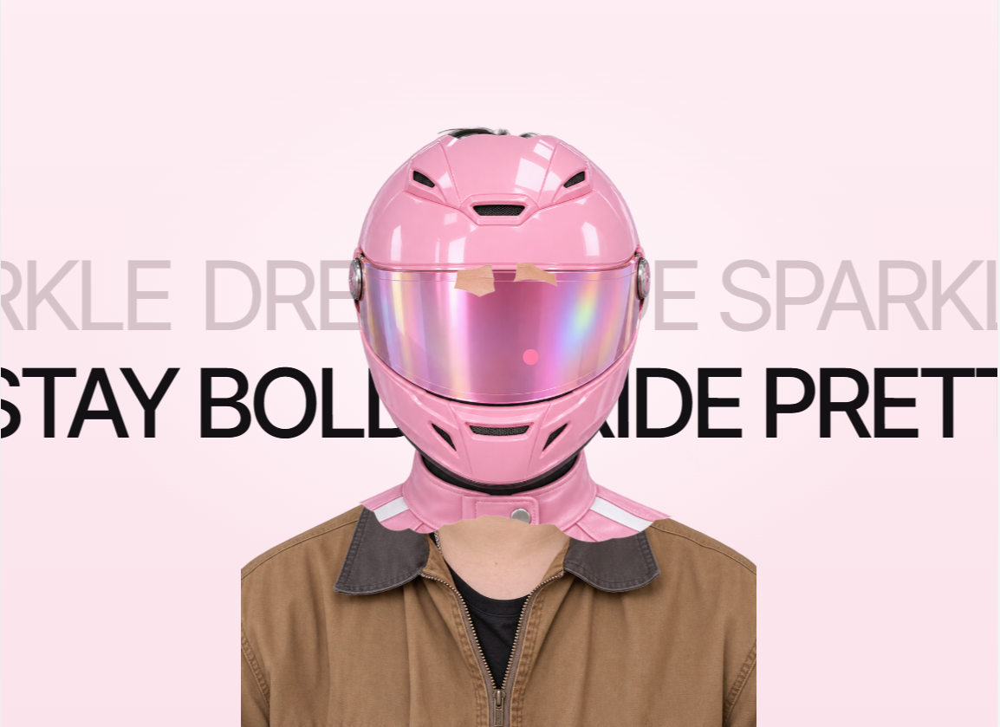
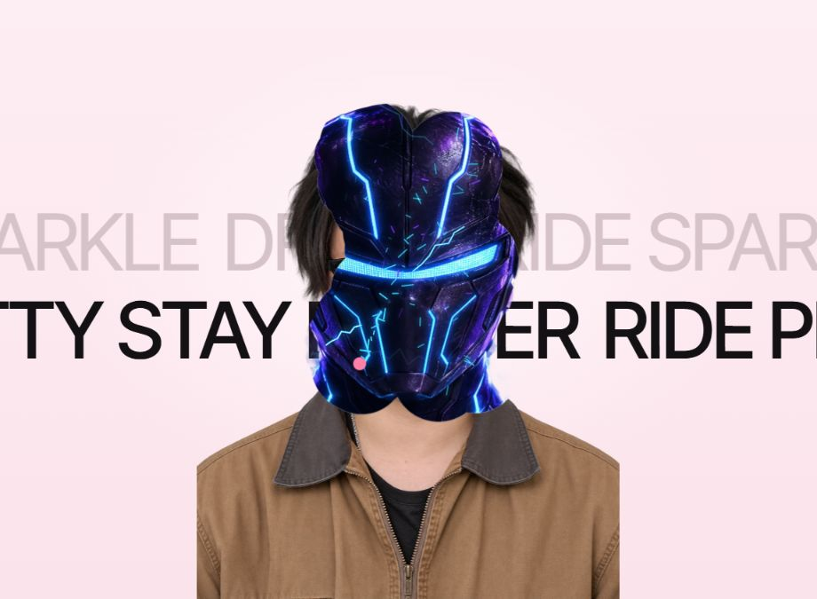
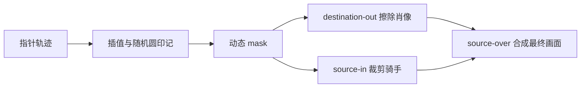

# WebDesign8-Rider

**一张肖像，两种骑士造型。** 用 Canvas 撕裂笔刷，让普通半身肖像在鼠标经过的位置切换成骑手装备。

<table>
  <tr>
    <td width="50%"></td>
    <td width="50%"></td>
  </tr>
  <tr>
    <td align="center"><b>Pink Rider · 粉色骑士</b></td>
    <td align="center"><b>Blue Lightning · 蓝色闪电</b></td>
  </tr>
</table>

封面记录的是交互中的一个瞬间；实际页面的骑手图层会随笔刷出现，再逐渐收回。

## 两个版本

原来的粉色版保留在 `index.html`，蓝色闪电版使用独立文件，两个版本可以分别下载、打开和展示。

| 版本 | 入口文件 | 骑手造型 | 交互特点 |
| --- | --- | --- | --- |
| 粉色骑士 | [index.html](./index.html) | 粉色头盔、虹彩面罩、白色条纹与心形贴章 | 硬边有机笔刷、1.1 秒缩小收回 |
| 蓝色闪电 | [blue-lightning.html](./blue-lightning.html) | 紫色装甲头盔、蓝色电路线条、青色面罩 | 同样的 Reveal，叠加蓝紫火花与短促闪电 |

两个文件都是独立 HTML 页面，CSS 和 JavaScript 内联，无框架、无构建步骤。点击上面的文件链接可以查看源码；要体验交互，请下载文件后在浏览器中打开。

## 设计亮点

- **浅粉舞台与高对比大字。** 柔和的粉色渐变背景托起居中的透明人物，浅灰和黑色两行大字在人物背后反向滚动，形成前后层次。
- **同一肖像、两种装备。** 两个版本共享原始半身肖像；换装只发生在笔刷覆盖的位置，保留真实人物与虚拟装备相互交错的效果。
- **硬边而非模糊光圈。** 多个随机圆叠加成不规则笔刷，轨迹边缘像撕纸；移开指针后印记缩小，原始肖像重新出现。
- **蓝版独立电光层。** 火花和锯齿闪电绘制在单独的全屏 Canvas 上，不改变人物遮罩，也不影响鼠标输入。
- **响应式画布。** 人物和电光分别依据各自显示区域调整尺寸，像素比限制为 `DPR ≤ 2`；触摸设备保留拖动和闲置自动游走。

背景文字为 `DREAM RIDE SPARKLE` 与 `RIDE PRETTY STAY BOLDER`，两行分别向左、向右连续运动。

## 鼠标撕裂 Reveal：具体实现

核心是 **动态遮罩 + Canvas 合成**。它不是把骑手图片半透明地盖在肖像上，而是先擦除肖像，再把骑手限制到同一块笔刷区域。

### 1. 把鼠标轨迹转换为人物局部坐标

页面监听 `pointermove` 和 `pointerdown`，以人物容器的 `getBoundingClientRect()` 为基准，将 `clientX / clientY` 转换为图像内部坐标。

为了避免快速移动时留下断点，脚本在前后两个点之间插值：

```js
const step = Math.max(W, 260) * 0.04;
const count = Math.min(40, Math.max(1, Math.ceil(distance / step)));
```

每次输入最多补入 40 个印记。指针离开时重置上一个位置，避免重新进入页面时出现横跨画面的连线。

### 2. 用 3～5 个圆生成一个有机笔刷

每个印记由随机角度、偏移和半径的 **3～5 个重叠实心圆**组成。圆的边缘保持硬边，随机叠加后形成不规则轮廓。

```js
const base = Math.max(W, 260) * (coarse ? 0.15 : 0.12);
const n = 3 + Math.floor(Math.random() * 3);
stamps.push({ x, y, t: now, lobes });
```

触摸设备使用稍大的笔刷，方便手指操作。

### 3. 每帧重画动态遮罩

隐藏的 `mask` Canvas 存储当前所有有效印记。每个印记的生命周期是 **1100ms**：前约 **275ms** 保持原尺寸，随后逐渐缩小，过期后删除。

```js
const k = Math.max(0, 1 - age / LIFE);
const scale = k < 0.75 ? k / 0.75 : 1;
```

各个圆的偏移量随 `scale` 缩小，半径随 `scale ** 0.8` 缩小。因此视觉上的“消退”主要来自轮廓收缩，不是整块图像简单降低透明度。

### 4. 用 destination-out 擦除肖像

主画布先用 `source-over` 绘制原始肖像，再切换到 `destination-out`，画入遮罩：

```js
ctx.globalCompositeOperation = 'source-over';
drawCover(ctx, front);

ctx.globalCompositeOperation = 'destination-out';
ctx.drawImage(mask, 0, 0, W, H);
ctx.globalCompositeOperation = 'source-over';
```

遮罩的实心区域会把原始肖像完全擦除。

### 5. 用 source-in 把骑手裁剪到同一块遮罩

离屏缓冲画布 `buf` 先画遮罩，再设置 `source-in`：后续绘制的骑手图像，只保留在遮罩范围内。

下面是蓝色版的合成步骤；`rider` 是预先校准好尺寸的骑手缓存画布：

```js
bctx.globalCompositeOperation = 'source-over';
bctx.clearRect(0, 0, W, H);
bctx.drawImage(mask, 0, 0, W, H);

bctx.globalCompositeOperation = 'source-in';
bctx.drawImage(rider, 0, 0, W, H);
bctx.globalCompositeOperation = 'source-over';

ctx.drawImage(buf, 0, 0, W, H);
```

粉色版在这一步直接用 `drawCover(bctx, back)` 绘制骑手图片。



这样，笔刷外显示原始肖像，笔刷内显示骑手。**即使骑手 PNG 的某些部位透明，笔刷实心区域里也不会露出已经擦除的原始人物**，而是露出页面背景。笔刷收缩后，下一帧重新绘制的肖像自然恢复。

### 6. 蓝色版：把横版骑手对齐到半身肖像

蓝色骑手原图是 `2752 × 1536` 的横版透明素材，直接套用普通 `cover` 会造成头盔大小和身体位置不匹配。

`prepareRider()` 会先将素材注册到肖像的头肩位置：

- 头盔与上半部依据人物容器的相对高度、宽度及顶部偏移绘制。
- 在源图约 86% 高度处分段，把下方胸甲延展到人物裁切区域的底部。
- 校准结果画入独立 `rider` Canvas，只在骑手图片加载完成和窗口尺寸改变时重算。

因此，每帧合成只需将这个缓存画布一次性画入 `buf`，既保持头肩对齐，也避免对同一张大图反复进行分段计算。蓝色版还会等待 `backReady` 后才擦除肖像，防止骑手图片加载期间出现空洞。

## 蓝色闪电与火花

蓝色版新增装饰画布 `#sparks`，覆盖 Hero，使用 `pointer-events: none`。它与人物 Canvas、笔刷遮罩分离，最后叠加显示。

### 火花粒子

`emitElectric()` 在指针移动时沿前后位置生成短线粒子，每次最多 6 个：

- 约 70% 使用青蓝色，其余使用紫色。
- 初始速度随机，随后加入阻力和轻微重力。
- 每帧根据时间差 `dt` 更新位置、速度与生命值，适配不同刷新率。
- 同时存在的粒子限制为 180 个，过期后移除。

### 六段锯齿闪电

闪电由 7 个点连接成 **6 段折线**，沿随机方向展开，并在中间加入横向扰动，形成电弧轮廓。

- 指针移动距离越大，触发电弧的概率越高；按下指针也会触发一次。
- 每道电弧持续约 **140～190ms**，按创建时间快速淡出。
- 外层是带蓝色辉光的较粗线条，内层是更细、更亮的浅色电芯。
- 同时存在的电弧限制为 20 道。
- 绘制时使用 Canvas 的 `lighter` 合成，并通过 `save()` / `restore()` 隔离状态，不影响人物的擦除与裁剪。

用户启用系统的“减少动态效果”偏好时，蓝色版跳过火花和闪电；人物 Reveal 仍然可用。

## 移动端与加载

- `matchMedia('(hover: none), (pointer: coarse)')` 实时判断触摸输入，并监听设备能力变化。
- 手指拖动可以绘制 Reveal；闲置约 **2500ms** 后，笔刷自动缓慢游走。蓝色版的电光也会跟随这条轨迹。
- 两个版本的原始肖像都内嵌在 HTML 中；粉色版的骑手图也内嵌在文件中。
- **蓝色版的骑手图通过原始 CloudFront URL 在线加载，需要网络连接。** Google Fonts 字体也通过网络加载；字体不可用时使用系统字体回退。

## 运行方式

下载整个仓库，或下载想体验的 HTML 文件，使用现代浏览器直接打开：

- `index.html`：粉色骑士
- `blue-lightning.html`：蓝色闪电

也可以在仓库目录运行任意静态服务器，例如：

```bash
npx serve .
```

再访问服务器地址下的 `/index.html` 或 `/blue-lightning.html`。

## 文件结构

```text
WebDesign8-Rider/
├── index.html           # 原粉色骑士版
├── blue-lightning.html  # 新蓝色闪电版
├── cover.png            # 粉色版封面
├── cover-blue.jpg       # 蓝色版封面
├── pink-rider.png       # 粉色骑手独立素材，页面本身已内嵌
└── README.md
```

技术栈：HTML、内联 CSS、原生 JavaScript、Canvas 2D、Inter Tight。
